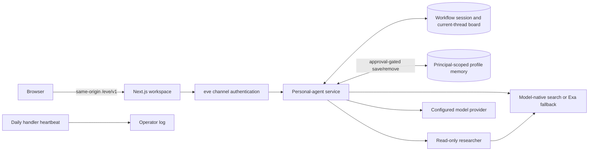

# Evermote

Evermote is an open-source **personal-agent starter** for deliberate work. It
combines resumable conversations, explicit scoped memory, read-only research,
and approval-gated planning in a calm browser workspace built with
[eve](https://eve.dev).

> [!IMPORTANT]
> Evermote is experimental `0.x` software, not a turnkey production service. It
> currently performs no external write actions and no user-facing background
> work. Production browser access stays closed until the deployer adds real
> authentication and per-session authorization.

## Capability contract

This table is the source of truth for what the checked-in project does and does
not claim.

| Area | Status | Current boundary |
| --- | --- | --- |
| Personal-agent workspace | Implemented | A responsive, keyboard-usable browser surface for conversation, current focus, commitments, confirmed decisions, and visible control prompts. |
| Real model conversation | Implemented | Messages stream from the configured model through eve; responses are not canned. |
| Session continuity | Implemented, storage-dependent | A `/s/:sessionId` URL can replay history and reconnect to an in-flight turn. Survival across process or container replacement depends on the configured Workflow store and retention policy. A session ID is not authorization. |
| Turn control | Implemented | A user can cancel a response, steer a busy turn, attach files, and answer supported human-in-the-loop prompts. |
| Current-thread board | Implemented | Focus, commitments, and confirmed decisions persist inside one session. Every mutation pauses for fresh human approval and includes an expected revision to reject stale updates. It is not a cross-session task manager, scheduler, or proof that work happened. |
| Profile memory | Partial; storage and identity required | A bounded profile document can carry low-sensitivity facts across sessions for a trusted `user` principal. Agent policy requires an explicit request before proposing a save or removal; every mutation then requires fresh approval. There is not yet an inspect, export, correction, expiration, or deletion-management UI. |
| Public-web research | Implemented, read-only | The root agent and a narrower researcher can use hosted search. Queries and results cross the configured model/search-provider boundary; neither agent has a research-side write tool. |
| External actions | Not implemented | There are no email, calendar, messaging, purchase, operating-system, arbitrary fetch, shell, or file-write actions. Discussing an action does not authorize or perform it. |
| User-facing proactive work | Not implemented | The service does not continue a user's task, send a reminder, or contact anyone in the background. The daily schedule is an operator heartbeat only. |
| Production login | Integration required | The checked-in placeholder rejects ordinary production browser traffic. Vercel OIDC authenticates supported service calls; it is not an end-user account system. |
| Session ownership ACL | Integration required | This repository does not ship a finished per-user session-ownership layer. A production deployment must bind every create, read, stream, message, cancel, clear, and reset operation to the authenticated user and tenant. |
| Provider choice | Configurable in code | The starter uses an OpenAI model through Vercel AI Gateway. A deployer can change the server-side model seam and credentials; the default is not local-only processing. |
| Ambient context | Decorative unless documented | Visual activity, awareness, or environmental cues do not imply microphone, camera, calendar, location, desktop, or sensor access. |

An assistant-owned or shared commitment is marked `active-turn-only`. It is not
a promise of asynchronous execution, notification, or completion. Read the full
[Agent contract](docs/AGENT_CONTRACT.md) before adding tools or integrations.

## Why a personal agent

- **Continuity with limits:** resume a conversation and keep a small amount of
  explicitly approved personal context without pretending that every state is
  permanent.
- **Inspectable commitments:** current focus, commitments, and confirmed
  decisions live in typed state and change only after approval.
- **Bounded delegation:** a separate research specialist has a narrower,
  read-only tool surface.
- **Receipts over claims:** the agent is instructed not to claim that it acted,
  remembered, verified, or changed state until the corresponding operation
  succeeds.
- **Operator control:** model choice, identity policy, persistence, retention,
  and hosting stay visible in source and deployment configuration.

## Architecture at a glance



The browser does not receive a model API key. `eve/next` connects the Next.js
application to the separately built agent service. The channel decides which
callers may reach session routes; a production application must additionally
enforce session ownership. The configured `just-bash` environment is dormant
because no checked-in tool exposes it, and it is not a native isolation
boundary. See [Architecture](docs/ARCHITECTURE.md).

## Requirements

- Node.js `24.x`
- pnpm (use the version pinned in `package.json`)
- A model connection accepted by eve, or an `AI_GATEWAY_API_KEY`
- For production profile memory: a trusted user principal and either private
  Vercel Blob or an explicit self-hosted `MemoryDocumentBackend`
- For production session continuity: a durable Workflow store and an explicit
  retention policy

The source is MIT-licensed. Model calls, hosted search, storage, and runtime
infrastructure can incur charges from the providers a deployer chooses.

## Run locally

```bash
git clone https://github.com/Bosheng2020/evermote.git
cd evermote
corepack enable
pnpm install --frozen-lockfile
cp .env.example .env.local
pnpm dev:web
```

Open the local URL printed by Next.js. The `withEve` integration starts the eve
development service and proxies same-origin agent routes. For the terminal-only
agent experience, run `pnpm dev`.

On first use, eve may ask you to connect a supported model account. For a
non-interactive setup, put `AI_GATEWAY_API_KEY` in `.env.local`; never commit
that file. In `eve dev`, profile memory uses one shared, process-local
`local-dev` scope and disappears with the process. Do not use local development
with real multi-user, personal, or secret data.

## Verify a change

```bash
pnpm typecheck
pnpm build:agent
pnpm build:web
pnpm eval --list
```

The build checks run in GitHub Actions. A successful build proves only that the
source compiles. A behavioral eval is a regression signal, not proof that
authentication, authorization, consent, privacy, persistence, or model behavior
is correct. See [Evaluation](docs/EVALUATION.md).

## Deploy

Set `NEXT_PUBLIC_SITE_URL` to the deployment's stable public origin before a
self-hosted production build. Evermote uses it for canonical links, Open Graph,
`robots.txt`, `sitemap.xml`, and structured data. Vercel's production hostname
is used automatically when the explicit value is absent. Preview deployments
should not replace the canonical production origin.

### Vercel

Vercel is the integrated path for the web application, eve service, Workflow,
schedules, and private profile-memory storage:

```bash
pnpm exec eve link
pnpm exec eve integration setup file-memory
pnpm exec eve deploy
```

Before accepting browser traffic, replace `placeholderAuth()` in
`agent/channels/eve.ts`, enforce per-principal session ownership, define data
retention and deletion procedures, and test with two distinct principals. The
memory integration alone does not create an end-user identity system.

### Self-host

The generated Node service can run on infrastructure you control:

```bash
pnpm build:agent
PORT=3000 pnpm start -- --host 0.0.0.0
```

This is a documented source path, not a turnkey secure deployment. The operator
must provide the separately built web application, TLS, process supervision,
model credentials, route authentication, per-session authorization, durable
Workflow storage, a production profile-memory backend, retention/deletion
procedures, and correct proxying for `/eve/` and `/.well-known/workflow/`.
Publishing the repository to GitHub does not run the agent. Read
[Deployment](docs/DEPLOYMENT.md) before exposing an instance.

## Search and answer-engine discovery

Evermote publishes standards-based discovery surfaces for the public project
pages: canonical metadata, a generated social preview, `robots.txt`,
`sitemap.xml`, a web-app manifest, and schema.org `WebSite`,
`WebApplication`, and `SoftwareSourceCode` data. The server-rendered
`/about` route is the concise, citable capability overview.

Conversation URLs under `/s/` are deliberately excluded from search through
HTML metadata and `X-Robots-Tag` headers, are omitted from the sitemap, and use
private no-store response headers. Those controls are not authentication: a
production operator must still enforce trusted identity and per-session access
for every session operation.

The optional `/llms.txt` endpoint is an experimental documentation map. It is
not a ranking mechanism, crawler permission, security control, or substitute
for public HTML, the sitemap, source documentation, or observable behavior.
After deployment, validate the canonical host and metadata routes, then submit
the sitemap through the search-engine webmaster tools you choose.

## Repository map

```text
agent/                     agent config, tools, memory, schedule, sandbox, subagent, and channel
apps/web/                  Next.js personal-agent workspace
evals/                     behavioral and schedule regression checks
docs/                      agent contract, data boundaries, architecture, deployment, and security
.github/                   CI and contribution templates
```

## Data, security, and privacy

Treat prompts, attachments, transcripts, board entries, saved profile facts,
search queries, tool arguments, and logs as sensitive. Depending on deployment,
they may be processed or retained by model, search, hosting, observability, and
storage providers. Evermote does not promise local-only or local-first
processing.

Read [Data and privacy](docs/DATA_AND_PRIVACY.md), the
[Threat model](docs/THREAT_MODEL.md), and [Security policy](SECURITY.md) before
using real personal data or deploying to other users.

## Independent project

Evermote is an independent community project. It is not an OpenAI product and
is not affiliated with, sponsored by, or endorsed by OpenAI. It contains no
OpenAI or ChatGPT source code, private API, brand asset, or proprietary design.
See [Notices](NOTICE.md).

## Contributing and license

Start with [Contributing](CONTRIBUTING.md) and follow the
[Code of Conduct](CODE_OF_CONDUCT.md). Evermote is licensed under the
[MIT License](LICENSE); third-party packages remain subject to their own
licenses and notices.
