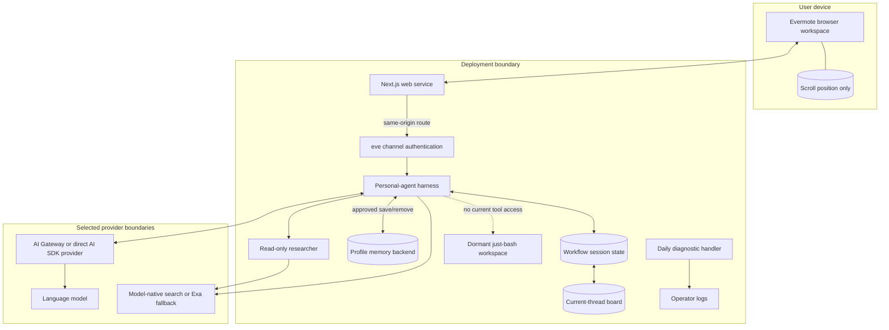

# Architecture

This document describes the checked-in architecture of the Evermote
personal-agent starter. It targets eve `0.81.1`; eve is pre-1.0, so confirm
framework behavior against the installed version before changing runtime code.

## Design goals

1. Keep the agent's authority smaller than the user-facing promise.
2. Make continuity, memory, approval, and data boundaries visible and testable.
3. Keep model and provider selection outside the browser application.
4. Separate current-thread planning state from cross-session profile memory.
5. Keep production browser traffic fail-closed until an operator configures
   trusted identity and per-session authorization.
6. Support an integrated Vercel path and an operator-managed Node path without
   calling either one turnkey production.
7. Label decorative context and roadmap behavior so the interface never implies
   a permission or completed action the runtime does not have.

The product-level authority rules live in the
[Agent contract](AGENT_CONTRACT.md).

## System context

The browser does not receive a model API key. The primary trust boundaries are:

- browser to runtime, where authentication and session ownership are required;
- runtime to model/gateway and hosted search, where prompts, attachments, and
  queries can leave the deployment;
- runtime to Workflow and profile-memory stores, where retention and erasure
  must be configured; and
- runtime to operator logs and traces, which can contain sensitive context.

## Source layout

| Path | Responsibility |
| --- | --- |
| `agent/agent.ts` | Root model, reasoning, and default-tool configuration. |
| `agent/instructions.md` | Authored personal-agent identity and behavioral policy. |
| `agent/channels/eve.ts` | HTTP session channel and ordered authentication policy. |
| `agent/tools/` | Focused questions, hosted web search, and current-thread board tools. |
| `agent/lib/session-board.ts` | Typed focus, commitments, and user-confirmed decisions for one Workflow session. |
| `agent/memory/profile.ts` | Bounded profile document with trusted-user scoping and approval-gated save/remove operations. |
| `agent/subagents/researcher/` | Separately instructed specialist with only public-web search. |
| `agent/schedules/heartbeat.ts` | Handler-only structured health log; no model session. |
| `agent/sandbox.ts` | Explicit in-process `just-bash` selection, currently unreachable from agent tools. |
| `apps/web/app/` | Next.js routes and personal-agent workspace. |
| `apps/web/app/_components/` | Streaming, composer, activity, memory, controls, and interaction components. |
| `apps/web/components/` | Reusable UI primitives and AI message renderers. |
| `apps/web/next.config.ts` | `eve/next` integration pointing at the repository root. |
| `evals/` | Behavioral and deterministic schedule regression checks. |
| `docs/` | Product contract, data map, evaluation, architecture, deployment, and security boundaries. |

There is no model-provider SDK in the browser application. The starter selects
an OpenAI model by AI Gateway model ID in `agent/agent.ts`; a deployer can
replace that server-side seam with a compatible provider-authored AI SDK model.
This is replaceable configuration, not a claim of local processing.

## Request and session flow

1. The browser creates or resumes an eve client with `useEveAgent`.
2. `eve/next` exposes same-origin `/eve/v1/*` routes and connects them to the
   separately running agent service.
3. `agent/channels/eve.ts` evaluates its authentication chain before model work
   begins. Local development and supported Vercel service calls are recognized;
   the placeholder rejects ordinary production browser traffic.
4. A production integration must additionally bind every session operation to
   the authenticated user and tenant. The checked-in channel does not provide a
   complete session-ownership ACL.
5. The first accepted message creates an eve Workflow session. The UI replaces
   the route with `/s/:sessionId` without detaching the active stream.
6. Before each turn, the profile slot accepts only a `user` principal supplied
   by trusted production authentication or eve's synthetic `local-dev`
   principal. Service, anonymous, and runtime principals receive no profile.
7. The harness composes instructions, recalled profile context, and session
   context, then calls the configured model.
8. The agent can use hosted public-web search directly or delegate a public
   research task to its narrower specialist.
9. A current-thread board mutation or profile-memory save/remove pauses for
   fresh approval. The explicit-intent requirement is behavioral policy; the
   approval is the execution boundary for that exact tool call.
10. The browser reduces stream events into messages, tool states, approval
    prompts, questions, errors, and completion state. Reloading a surviving
    session replays stored events and follows an unfinished turn.
11. Cancellation and steering settle through the eve session protocol.

A session ID is an address, not proof of identity or ownership.

## State ownership and lifetime

| State | Owner | Lifetime and limits |
| --- | --- | --- |
| Conversation events and run state | eve Workflow runtime | Durable only according to the selected Workflow world and retention policy. |
| Focus, commitments, and confirmed decisions | Typed state inside the current Workflow session | Board mutations require the reviewed revision plus fresh approval; state is not copied to another session and does not prove execution. |
| Profile facts and preferences | Bounded `fileMemory()` document behind a trusted-user scope | Can cross sessions with a stable principal and production backend; every save/remove requires approval. |
| Model and provider records | Selected provider and operator observability | Governed by provider and operator configuration, not the browser UI. |
| Transcript rendering | Browser memory reconstructed from eve events | Presentation of stored events, not a separate source of truth. |
| Scroll position | Browser `sessionStorage` | Presentation-only and keyed by session. |
| Ambient visual state | Browser UI | Decorative unless a documented capability supplies it. |
| Public-web research | Hosted model/search provider and session state | Queries and results cross a provider boundary; no research write tool exists. |
| Sandbox workspace | eve `just-bash` provider | In-process virtual shell/filesystem, but no checked-in tool currently opens or executes in it. |
| Heartbeat | Scheduler and operator log | Fixed diagnostic event; no user session, memory, or delivery. |

An assistant-owned or shared commitment carries
`assistantScope: "active-turn-only"`; it is not a background job,
notification, or guarantee of completion. Every mutation includes the reviewed
board revision so an approved but stale update fails instead of overwriting
newer state.

The current state key is `evermote.session-board.v2`. Its incompatible shape
change intentionally starts a fresh board for sessions that only contain v1
state; conversation events are a separate persistence domain.

## Persistence by environment

### Local development

The default local Workflow world stores state under
`.eve/.workflow-data`. That ignored directory can contain sensitive session
content and is not a backup or multi-node storage design.

Separately, `fileMemory()` selects one shared, process-local document for the
synthetic `local-dev` principal. It is lost on process exit. All local
conversations can resolve to that same profile, so local development must not be
used with real multi-user or sensitive personal data.

### Vercel

The integrated path uses Vercel Workflow for sessions and, after explicit
setup, private Vercel Blob for profile memory. A deployment without the required
memory binding should fail when profile memory is used rather than silently fall
back to a shared process-global document.

Vercel OIDC supports trusted Vercel service calls. It does not create an end-user
account system or per-user session ACL.

### Self-hosted production

An operator must persist `.eve/.workflow-data` or configure a compatible
Workflow world. The checked-in `fileMemory()` auto-selection does not choose a
backend outside Vercel or `eve dev`, so self-hosters must supply an explicit
`MemoryDocumentBackend`.

The operator owns migrations, tenant isolation, encryption, backups, restore
testing, retention, erasure, and regional placement for both persistence
domains. See [Deployment](DEPLOYMENT.md).

## Deployment topologies

| Topology | Web and agent | Workflow state | Profile memory | Intended use |
| --- | --- | --- | --- | --- |
| Local development | Next.js plus eve dev | Local `.eve` data | Shared process memory | Development with synthetic, non-sensitive fixtures |
| Vercel | Next.js plus generated eve service | Vercel Workflow | Private Blob after setup | Integrated hosted starting point; user auth/ACL still required |
| Self-hosted, combined | `next start` manages the built eve child | Local or custom world | Explicit backend required | One supervised application unit |
| Self-hosted, split | Next.js and supervised `eve start` | Local or custom world | Explicit backend required | Separate scaling and failure domains |

Publishing the source to GitHub does not run the application. None of these
rows is a claim that authentication, privacy policy, retention, or production
operations are complete.

## Authentication and authorization

The checked-in channel walks:

1. `vercelOidc()` for supported authenticated Vercel callers;
2. `localDev()` for genuine local development; and
3. `placeholderAuth()`, which authorizes no ordinary production browser.

This is a fail-closed scaffold, not user login. A deployment must replace the
placeholder with an authenticator appropriate to its users and enforce
per-principal, per-tenant ownership for create, read, stream, message, cancel,
clear, and reset operations.

The profile-memory scope trusts the `user` principal produced by that
authentication layer. Checking `principalType` is not independent identity
verification.

The health endpoint is intentionally public and must never include secrets or
user data.

## Scheduled heartbeat

The daily `04:17 UTC` heartbeat is a handler-only operation that writes one
structured event to the runtime log. It does not open an agent session or invoke
a model, so it has no agent tools, profile memory, research, approvals, or
inference/search spend.

It is a process-level signal, not an end-to-end model health check, reminder,
agent loop, or user-facing proactive task. Operators need separate cron-delivery
and log-based alerting if they depend on it.

## Sandbox boundary

`agent/sandbox.ts` pins eve to `just-bash` with automatic package installation
disabled. The current agent disables default tools and has no authored tool
that calls `ctx.getSandbox()`, so the model cannot run commands or browse the
virtual filesystem through the checked-in surface.

`just-bash` runs in the host Node.js process. It is a deterministic
compatibility layer, not OS-, container-, or VM-level isolation. Any future
shell, file, executable-code, or arbitrary-network tool requires a reviewed
native sandbox, egress and resource limits, and an updated threat model.

## Extension rules

- **Model:** keep credentials server-side and update provider disclosures.
- **Behavior:** change instructions and add behavioral evals, but do not confuse
  an eval with deterministic enforcement.
- **State:** define scope, lifetime, approval, migration, export, and erasure.
- **Tools and connections:** use narrow schemas, least-privilege credentials,
  per-action approval for consequential writes, receipts, and revocation.
- **Channels:** add trusted identity mapping, signature checks, and session
  ownership.
- **Schedules:** keep operations diagnostics separate from user-created,
  revocable proactive work.
- **Memory:** retain approval for mutations and add inspect, correct, export,
  expire, and delete controls before broader capture.

Every new tool, connection, channel, schedule, or memory store changes the
[Agent contract](AGENT_CONTRACT.md), [Data map](DATA_AND_PRIVACY.md), and
[Threat model](THREAT_MODEL.md) and must update them in the same pull request.

## Architectural non-goals

- implementing a proprietary client or private protocol;
- implicit microphone, camera, location, calendar, desktop, or input access;
- treating model output as trusted code, identity, authorization, or proof;
- silent or unaudited high-impact actions;
- background-work claims without a real scheduler, user controls, and receipts;
- calling a hosted-provider default local-only or local-first; and
- presenting a dormant compatibility sandbox as a security boundary.
