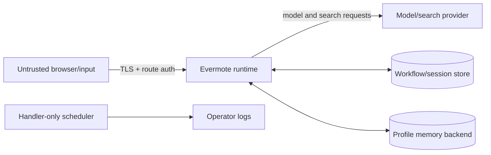

# Threat model

This is a living threat model for the checked-in Evermote `0.x`
personal-agent starter. It is not a certification, penetration-test report, or
guarantee. Revisit it whenever a tool, connection, channel, schedule, memory
store, authentication method, or deployment topology changes. The intended
authority boundary is defined in the [Agent contract](AGENT_CONTRACT.md), and
the data inventory is in [Data and privacy](DATA_AND_PRIVACY.md).

## Scope and assumptions

In scope:

- the browser UI and same-origin Next.js routes;
- eve session, stream, control, callback, and health routes;
- model requests and streamed responses;
- session/workflow persistence;
- principal-scoped profile memory and the current-thread board;
- provider-managed public-web search and the researcher subagent;
- the explicitly configured in-process `just-bash` virtual workspace;
- the daily heartbeat schedule;
- file attachments accepted by the composer; and
- build, dependency, and deployment configuration in this repository.

The current repository does not enable a microphone, camera, location API,
OS-level observer, or external-service write tool. It does enable read-only
hosted web search, a bounded model-maintained profile document, approval-gated
profile and current-thread-board mutations, and a daily diagnostic schedule.
It performs no user-facing background work. If a fork adds another capability,
that capability is outside this document until the threat model is updated.

We assume the host operating system, TLS terminator, selected model provider,
package registry, and any configured identity provider can affect security. We
do not assume model output is correct, safe, or honest.

## Assets to protect

- model, identity-provider, hosting, and integration credentials;
- prompts, responses, attachments, and derived personal information;
- saved profile facts, web-search queries, and current-thread board entries;
- session IDs, workflow callbacks, and authentication tokens;
- model spend and infrastructure availability;
- the integrity of agent instructions and deployed source;
- user trust in which capabilities are real, simulated, or absent;
- the accuracy of approval prompts and success/failure receipts; and
- the boundary between a commitment and work actually performed.

## Threat actors

- an unauthenticated internet client;
- one authenticated user attempting to access another user's session;
- malicious content in a prompt, attachment, model response, recalled memory,
  or web result;
- a compromised dependency or CI action;
- a malicious or over-privileged future tool/connection; and
- an operator mistake, such as public anonymous auth or ephemeral workflow
  storage.

## Trust boundaries

Crossing a boundary requires a technical control. A prompt instruction is not
an authentication, authorization, or isolation control.

## Threats, present controls, and required hardening

| Threat | Present control | Remaining work for production |
| --- | --- | --- |
| Unauthorized session creation or reading | eve applies route auth before session work; the checked-in placeholder fails closed in production. | Replace the placeholder with real user auth and enforce per-principal session access. Test create, resume, stream, cancel, clear, and reset routes. |
| Leaked session URL | Session routes still require route auth. | Do not treat the session ID as a bearer secret; avoid analytics/referrer leakage and never authorize by ID alone. |
| Cross-site request or credential abuse | Browser calls are same-origin by default. | Set strict allowed origins, secure/SameSite cookies, CSRF defenses appropriate to the chosen auth, and a restrictive CSP. |
| Prompt injection | Public-web tools are read-only; the researcher has only web search; current-thread-board and profile-memory mutations require approval. | Treat prompts, attachments, search results, recalled memory, and model output as untrusted. Approval limits execution of one proposed mutation but does not make its content trustworthy; add deterministic validation where policy requires it. |
| Malicious attachment | Attachments travel through the session/model path. | Enforce type and size limits server-side, scan where appropriate, avoid executing content, and document provider retention. |
| Secret exposure | Local env files and generated outputs are gitignored; credentials are not needed in browser code. | Use a secret manager, rotate exposed keys, scope credentials, keep secrets out of `NEXT_PUBLIC_*`, logs, screenshots, and CI artifacts. |
| Cost or resource exhaustion | Cancellation is supported. | Add authentication, rate limits, concurrency and upload limits, model budgets, timeouts, and spend alerts. |
| Unsafe rendered model output | React rendering avoids raw HTML by default in ordinary components. | Preserve renderer sanitization, review Markdown/code/diagram plugins, block dangerous URL schemes, and test stored/rendered XSS payloads. |
| Workflow callback forgery or loss | eve owns its callback protocol. | Expose the required callback route only through TLS, preserve paths, configure the correct public prefix, and follow the installed eve version's verification guidance. |
| Lost or cross-tenant workflow data | Local data stays outside Git. | Use durable storage, tenant-aware authorization, encryption, backups, retention and deletion procedures; test restore and erasure. |
| Cross-principal profile memory | A custom scope accepts only `user` principals supplied by the configured authenticator (plus synthetic `local-dev`) and then uses `byPrincipal`; service/anonymous/runtime principals are disabled. | Return a unique verified user principal from production auth; test two-user isolation, deletion, namespace behavior, and deploy/preview separation. The scope does not verify identity itself. |
| Memory poisoning, staleness, or sensitive capture | File memory has no automatic post-turn capture, a 4,000-character recall cap, instructions restrict content to explicit low-sensitivity facts, and each save/remove call requires approval. | Approval is not content validation. Add deterministic filtering where required; treat recalled content as untrusted; provide inspect/correct/export/expire/delete UX; never use shared `local-dev` with real data. |
| Search-query disclosure | Web search is read-only and handled by the selected model/search provider. | Disclose that queries leave the runtime, avoid secrets/private data in searches, and choose a provider whose region and retention meet requirements. |
| Scheduled task abuse | The heartbeat is handler-only: it writes a fixed JSON log and opens no model session, so agent tools, memory, research, approvals, and inference/search spend are absent. | Monitor cron delivery and log access; review the implementation if the handler gains network or storage work later. |
| Sandbox escape, host impact, or SSRF | The sandbox provider is pinned to in-process `just-bash`, package auto-install is off, and no checked-in tool currently exposes its shell or filesystem; public-web search is provider-managed rather than arbitrary URL fetch. | Do not treat `just-bash` as native isolation. Before exposing executable, filesystem, or arbitrary-fetch tools, move untrusted work to a hardened container/VM provider, deny unnecessary egress and host mounts, set resource limits, and patch the runtime. |
| Supply-chain compromise | Lockfile is committed and CI uses frozen installs. | Review dependency updates, pin CI actions, enable Dependabot/security scanning, and investigate lifecycle scripts and new transitive code. |
| Misleading ambient UI | README labels undocumented context as simulated. | Keep capability labels near the UI, request consent at the moment of access, and make every sensor/integration revocable. |
| Provider data retention | Provider is selected server-side and can be changed. | Choose providers and regions that meet requirements; configure retention/training controls and give users an accurate privacy notice. |
| Approval fatigue, ambiguity, or replay | Board and memory tools request approval for each mutation and show the proposed operation. | Keep prompts specific, reject stale or replayed approvals, test denial and retry, and never treat one approval as standing authority. |
| False completion or over-delegation | Instructions prohibit claiming a state change before tool success; assistant/shared commitments carry an `active-turn-only` scope; no external-write tool exists. | Render failure clearly, test tool-error paths, distinguish a commitment from completed work, and never imply that assistant-owned work continues in the background. |
| Anthropomorphic trust | Product copy identifies Evermote as an agent, not a person, and documents absent capabilities. | Avoid emotional pressure, dependency cues, or claims of awareness; keep data, authority, and provider boundaries visible. |

## Specific security properties

### The placeholder authentication is fail-closed

`placeholderAuth()` is not anonymous access. It intentionally prevents an
ordinary browser from using the production agent until the operator makes an
explicit authentication choice. Do not “fix” a failed production chat by
blindly replacing it with `none()`.

Anonymous demos are inherently exposed to abuse and spend. If an operator
chooses explicit anonymous access, add strict rate, token, attachment, session,
and cost limits and make the data policy visible before input is submitted.

### Session durability and profile memory are different stores

A durable transcript can contain sensitive data and may outlive the browser
tab. Separately, the `profile` slot can outlive one session and is maintained
through model-visible save/remove tools. There is no automatic post-turn
capture. Instructions require an explicit request and low-sensitivity content,
and every proposed save or removal requires fresh approval.

Production authentication must provide a stable, verified `user` principal so
the custom gate and `byPrincipal` can isolate documents. Service, anonymous,
and runtime principals receive no profile slot. The model-interpreted
explicit-intent rule is behavioral policy; the approval gate is the execution
boundary for that exact mutation. Approval is not content validation. A
complete product also needs controls for inspection, correction, export,
expiration, and deletion.

Local `eve dev` intentionally collapses profile memory into one shared
process-local `local-dev` scope; it must never be used for real multi-user or
sensitive data.

### The heartbeat is diagnostic, not user automation

The heartbeat fires at `04:17 UTC` and writes a fixed structured event. Its
handler does not create an agent session or call a model, so it cannot reach
agent tools, profile memory, research, approval, or inference/search spend. It
does not deliver reminders or act for a user. It should still be covered by
cron-delivery and log-based failure monitoring.

An assistant-owned or shared commitment on the current-thread board is not
connected to the heartbeat and does not become a background job.

### The configured sandbox is dormant, not a security boundary

`agent/sandbox.ts` pins eve to `just-bash` with automatic package installation
disabled. This makes builds portable and gives eve a deterministic virtual
workspace if code later requests one. The current agent disables default tools
and has no authored tool that calls `ctx.getSandbox()`, so the model cannot run
commands or browse sandbox files through the checked-in tool surface.

`just-bash` is an in-process TypeScript shell and virtual filesystem. Its path
abstraction is not OS-, container-, or VM-level isolation from the host Node
process. Adding a shell, file, code-execution, or arbitrary-network tool changes
the risk materially and requires a reviewed native sandbox, resource and egress
limits, adversarial tests, and an update to this threat model.

### A provider-neutral seam is not local processing

Changing providers is possible, but the checked-in model ID uses a hosted
gateway. Unless an operator deliberately installs and configures a local model
provider, prompts and attachments leave the user's machine.

## Production hardening checklist

- [ ] Replace `placeholderAuth()` and test cross-user isolation.
- [ ] Keep all browser, callback, and model traffic behind TLS.
- [ ] Store secrets only in the deployment's secret manager.
- [ ] Configure rate, concurrency, upload, token, session, and spend limits.
- [ ] Set a documented retention and deletion policy for sessions and logs.
- [ ] Persist and back up the selected Workflow world, or explicitly accept
      ephemeral data.
- [ ] Provision private Vercel Blob for profile memory or configure an explicit
      self-hosted memory backend; test two-principal isolation and deletion.
- [ ] Test profile save/remove approval, denial, stale approval, backend failure,
      and false-success paths.
- [ ] Provide profile inspect, correct, export, expiration, and deletion
      procedures before storing real personal data.
- [ ] Monitor the daily heartbeat's cron delivery and structured log event.
- [ ] Re-evaluate `just-bash` before exposing any sandbox-backed tool; use
      native isolation for untrusted execution.
- [ ] Review provider data-use, training, region, and retention settings.
- [ ] Add CSP and other security headers appropriate to the deployed UI.
- [ ] Disable or constrain source maps and verbose errors in production.
- [ ] Verify both `/eve/` and `/.well-known/workflow/` routing where required.
- [ ] Patch Node, eve, Next.js, the AI SDK, renderers, and transitive
      dependencies promptly.
- [ ] Run a real authorization test and an end-to-end model turn after deploy.
- [ ] Document incident response, key rotation, export, and erasure procedures.
- [ ] Verify user-facing copy does not claim external actions, background work,
      local-only processing, or persistence beyond configured stores.

## Reporting

Report suspected vulnerabilities privately using [SECURITY.md](../SECURITY.md).
Do not place secrets, transcripts, or exploit details in public issues.
